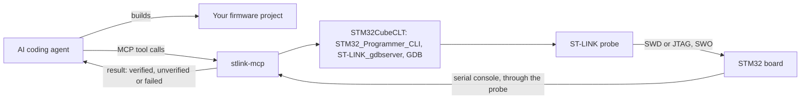

# stlink-mcp

An MCP server that lets an AI coding agent program, run and inspect an STM32 target over ST-LINK, with every result marked verified, unverified or failed, and the evidence for it. It runs locally, next to the board, and drives the STM32CubeCLT command line tools you already have installed. It reads variables and peripheral registers by name, from your ELF and ST's SVD files, without stopping the program; it refuses a read that would change what the firmware sees unless asked; and every result says whether the call halted or reset the target. With it attached, the agent runs the edit, build, load, observe loop itself, and you supervise its conclusions instead of relaying what the board did.

## Why the reports have to be true

An agent working on firmware is only as good as what the tools tell it about the board. A developer catches a tool that overstates, because they hold information the tool never gave them: the LED that did not change, console text that looks like the previous build, the board in their hand. An agent has none of that. The text a tool returns is its entire model of the hardware, so a tool that reports success for something it did not do makes the agent confidently wrong, and the agent then writes that wrongness into code, commit messages and documentation, where it costs far more than the failed operation did.

ST's command line tools do overstate. Three examples with an STM32N6:

* `STM32_Programmer_CLI -s <address>` printed "Start operation achieved successfully" while the program counter never left the boot ROM.
* `ST-LINK_gdbserver` printed "Failed to halt target". The core was fine; the server was on the wrong debug access port.
* A GDB load against a running target completed cleanly and changed nothing, so the previous program carried on and its output read as a successful new run.

An agent driving those tools inherits every one of them. So the rule here is:

> **A tool reports success only after checking that the thing it was asked to do actually happened.**

`run_firmware` reports success because the new image printed on its console, or because the program counter was seen inside it, not because GDB exited zero. Every result has one of three states, and no tool sets `ok` by hand:

| `status` | `ok` | meaning |
| --- | --- | --- |
| `verified` | `true` | checked, and `verified_by` names the observation |
| `unverified` | `false` | may well have worked, but nothing watched it |
| `failed` | `false` | it did not work, and `error` says why |

`unverified` is deliberately not `ok`: a run nobody watched is not a success, however likely it is to have worked. `unverified_because` says what was not checked, so it is not mistaken for a failure.

What the agent sees is a flat JSON object. A `run_firmware` result, with the fields as the server returns them and the values of an illustrative run on an STM32F407, looks like this:

```json
{
  "probe_serial": "0670FF3433554B3043165632",
  "elf_path": "/home/you/blink/build/blink.elf",
  "interface": "swd",
  "interface_clock_khz": 4000,
  "console_port": "/dev/ttyACM0",
  "console_port_source": "the probe's own port",
  "load_address": "0x20000000",
  "load_address_provenance": "measured",
  "image_initial_sp": "0x20020000",
  "image_entry_point": "0x200001a5",
  "load_size_bytes": 6180,
  "target_was_reset": true,
  "console": "blink 0.3 starting\r\nLED on\r\n",
  "ok": true,
  "status": "verified",
  "verified_by": "console output from this board's own port"
}
```

Had the board printed nothing, `ok` would be `false`, `status` `unverified`, and `unverified_because` would say that the image loaded and started but nothing was heard in the capture window.

## How it fits

The agent edits and builds the firmware as it already does. This server is the part that reaches the board: it drives ST's tools, and returns what they did as a result that says what was checked.



## Who this is for

Use it if your board has an ST-LINK, STM32CubeCLT is already installed, and you want an agent whose every report names what was observed on the target. It is debugging shaped for an agent rather than a person: sixteen tools, which read the target without stopping it where they can, stop it only where they are asked to, and say so whenever a call halted or reset it. Four things are left out, each for a reason:

* **Building firmware** is your build system's job, and the agent already runs it.
* **Single-stepping** is how a person explores code. An agent gets more from one call that runs to a chosen point or until a variable is written, and then returns the call stack, the registers and why it stopped, than from one call per instruction.
* **Writing memory** is left out until real use shows an agent needs it: a wrong write changes what the program does, and nothing in the result would show it.
* **RTT** (SEGGER's Real Time Transfer, a ring buffer the firmware writes and a debugger reads) is not supported by ST's tools. `sample_values` already watches values while the program runs; reading RTT logs may come later.

Use [stm32-gdb-mcp](https://github.com/Zeraissh/stm32-gdb-mcp) or [embedded-debugger-mcp](https://github.com/Adancurusul/embedded-debugger-mcp) if you need single-stepping, breakpoints you manage yourself or RTT, and embedded-debugger-mcp for a J-Link or DAPLink probe, a target that is not an STM32, or Windows support beyond what is measured here. [Related projects](#related-projects) has the comparison.

## Status

Alpha. Three device IDs are measured on hardware: 0x413 on an STM32F407, 0x450 on an STM32H743 and 0x486 on an STM32N657. The rest of the range is seeded at run time from STMicroelectronics' own device databases in your STM32CubeCLT install (with STM32CubeCLT 1.22.0, 96 more device IDs), and every value from there is labelled as such. Device IDs whose databases name several separate SRAM banks (`0x42B`, `0x42C`, `0x472` and `0x49A` in that version) are refused rather than guessed; `board_state` names the addresses it would not choose between, and a board file settles it. A part the database does not know still identifies itself. Every tool but `run_firmware` works on it; `flash_firmware` needs a .bin and an `address` there.

Versions follow [Semantic Versioning 2.0.0](https://semver.org/spec/v2.0.0.html) and are read from the git tag; a build past the last tag reports the tag plus the number of commits since it, as in `0.1.0+3`. A tree from GitHub's "Download ZIP" carries the same version; a plain copy of the files with neither reports `0.0.0+unknown`. The public API is the sixteen tools below, their parameters and result fields, and the `stlink-mcp` command line. At 0.y.z any of it may change. What has to happen before 1.0 is in [ROADMAP.md](ROADMAP.md), the measurements behind the claims in this file are in [docs/findings.md](docs/findings.md), changes are in [CHANGELOG.md](CHANGELOG.md), and how to report a problem or contribute a board you have measured is in [CONTRIBUTING.md](CONTRIBUTING.md).

## Requirements

* [STM32CubeCLT](https://www.st.com/en/development-tools/stm32cubeclt.html). It bundles STM32CubeProgrammer, the GDB server and the Arm toolchain. Found automatically in `stm32cubeclt*` directories under `/opt/st`, `~/st` or `/usr/local/st`, at `/Applications/STMicroelectronics/STM32CubeCLT` on macOS, and on Windows under `C:\ST`, where its installer puts it. Anywhere else, set `STLINK_MCP_CLT_ROOT` to the install directory. Without a complete STM32CubeCLT, the same three tools inside an [STM32CubeIDE](https://www.st.com/en/development-tools/stm32cubeide.html) install are used, from `stm32cubeide*` directories in the same places or from the install `STLINK_MCP_CLT_ROOT` names, and `--check` says so. Tested with STM32CubeIDE 2.2.0 on Linux, its SVD files included.
* Python 3.11 or newer.
* An ST-LINK, which on most development boards is on the board itself. ST's GDB server refuses probe firmware older than it supports, even where the programmer still uses it, and `run_firmware` then says so. `STLinkUpgrade.jar`, beside the GDB server in the install, updates it, from a shell with the Java runtime in the install: `java -jar STLinkUpgrade.jar -sn <serial> -update`, which programs only when the firmware is older.
* On Linux, membership of the `dialout` group for the serial console, and ST's udev rules for the probe (STM32CubeCLT installs these).

## Install

With [uv](https://docs.astral.sh/uv/) installed, the package on PyPI runs with no install step; `uvx stlink-mcp@0.8.5` pins a version. MCP clients that browse the [MCP Registry](https://registry.modelcontextprotocol.io/) find it as `io.github.dii/stlink-mcp`.

```sh
uvx stlink-mcp --check
```

To work on the code, clone the repository and run it from there:

```sh
git clone https://github.com/dii/stlink-mcp
cd stlink-mcp
uv sync
uv run stlink-mcp --check
```

`--check` reports the toolchain it found, the vendor database, any board file and the probes attached, then exits without starting the server. It lists probes the same way `list_probes` does, which neither halts nor resets them.

## Use it from an MCP client

```json
{
  "mcpServers": {
    "stlink": {
      "command": "uvx",
      "args": ["stlink-mcp"],
      "env": { "STLINK_MCP_CLT_ROOT": "/opt/st/stm32cubeclt_1.22.0" }
    }
  }
}
```

The `env` block is where the [settings](#configuration) go, and is needed only for those you change. With Claude Code, the same thing is:

```sh
claude mcp add stlink -e STLINK_MCP_CLT_ROOT=/opt/st/stm32cubeclt_1.22.0 -- uvx stlink-mcp
```

From a clone, the command is `uv --directory /path/to/stlink-mcp run stlink-mcp` in place of `uvx stlink-mcp`.

## Telling the agent how to use it

When it connects, the server gives every client a short guide: what it is for, how to read a result, and the usual order of calls. Claude Code shows it to the agent even when it has not loaded the tool descriptions. Some clients do not pass it on; for those, put the same text in your project's `AGENTS.md`, or whichever file your agent reads its instructions from:

```text
stlink-mcp drives STM32 boards through an ST-LINK probe with ST's STM32CubeCLT tools.

Every result has a status. verified: verified_by says what was observed. unverified: it may have worked, but nothing checked it, and unverified_because says why; this is not success. failed: error says why. Read the status before the values.

A usual session: `list_probes`, then `board_state` to identify the board. `run_firmware` loads an ELF linked for RAM and starts it; a build linked for flash, the default from STM32CubeIDE and CubeMX, goes `flash_firmware`, then `reset_target`, then `capture_console`. Without halting the program: `capture_console`, `capture_swo`, `sample_values`, `read_memory`, `read_fault_status`, `read_option_bytes` and `disassemble`. Halting it: `run_until`, `core_registers` and `locate_fault`. `reset_target` restarts it; `release_probe` when done.

Give `probe_serial` on every call: without it each call first lists the probes, which takes a second or more and holds up every other board. Give addresses as "0x..." strings and files as absolute paths. `run_firmware` lets go of the probe once the program starts; with `keep_probe=True` a GDB server keeps holding it, and while it does, a core that locks up is reset, which clears its fault registers. `reset_target` and `flash_firmware` stop a holding server first and say so. A call that halts or resets the target says so. If the running program has closed the debug port, `board_state` can get back in by resetting the target, and `reset_target` cannot; on an STM32N6 running ST's start-up code, only a power cycle does. An unknown argument is refused, not ignored.
```

## Tools

| tool | what it does | how it verifies |
| --- | --- | --- |
| `list_probes` | Lists attached probes, their firmware and their serial consoles, and marks those a GDB server holds | The programmer's own listing; errors it printed are returned beside it, since a probe this user cannot open prints an error and no entry |
| `board_state` | Identifies the target, the probe and the family, and says whether the core is running, sleeping, halted or locked up, without halting it | Tries access ports 0 and 1. The core's state from DHCSR, and five program-counter samples, placed in the source given `elf_path`. If no plain connect reaches the core it reconnects through a reset, and `target_was_reset` says so; beside a held GDB server it never resets |
| `run_firmware` | Resets the target, loads an ELF into RAM and starts it | Console output after the load, or else program-counter samples inside the image. What the probe kept from before the run never counts. `failed` if GDB did not finish the load. Refuses an image not [linked for RAM](#running-an-image-from-ram). Lets go of the probe once the program starts, unless `keep_probe` is true |
| `flash_firmware` | Writes a raw binary (.bin), an ELF or an Intel HEX file to flash, for the board to boot | Reads every written range back; only an identical readback is `verified`. Says what its erase took beyond the image. Does not start the image. See [Writing flash](#writing-flash) |
| `read_memory` | Reads 32-bit words, a variable by name, or a peripheral register by name, without halting or resetting the target | The words themselves. A variable is `verified` only when the target runs the ELF it was decoded with. Refuses a short read, and a register whose [read changes state](#reads-that-change-state) unless told `read_effects_ok` |
| `sample_values` | Samples up to eight variables, addresses or registers together, a few times a second for up to 60 s, without halting the program | Each value as itself if it never changed, or as first, last, range, number of changes and when it first changed, with how many samples found the core running, halted or otherwise. `until` stops at the first sample where a condition holds. A change and change back between two samples does not show |
| `core_registers` | Reads the core registers, halting the core for the read; with the ELF, the call stack with each frame's arguments and locals | The registers themselves. Says whether the core runs afterwards. Without the ELF, a core it cannot reach as it runs is reached through a reset, and the result says so. With the ELF it refuses instead of resetting, so the call stack it returns is always the running program's |
| `run_until` | Runs the target until it reaches a function, a line or an address, or writes a variable, and holds the core there | `verified` only when the chip's debug fault status register names a breakpoint or a watchpoint at the stop. A time limit that runs out is `unverified`. See [Stopping the target](#stopping-the-target) |
| `read_fault_status` | Reads and decodes the Cortex-M fault registers, without halting or resetting the target | The raw registers, a plain-English diagnosis, and the faulting address when the hardware recorded it. A clean read beside a held GDB server that caught a vector is `unverified`. Refuses Cortex-M0, M0+, M1 and M23 cores, which have no such registers |
| `locate_fault` | Finds the instruction that faulted, from the exception frame, halting the core for the read | The stacked PC, from the stack EXC_RETURN in LR names; with the ELF, its function, line and instruction. `unverified` when the words found do not look like a frame. Never resets, since a reset loses the fault |
| `disassemble` | Disassembles a function, or the code around an address, from the ELF | Each instruction with its source file and line. Given `probe_serial`, it also reads the target's code without halting it, and is `verified` only when that code is the ELF's |
| `read_option_bytes` | Reads the option bytes as ST's programmer explains them: readout protection, brown-out level, user configuration, boot addresses, write protection | Read only: no tool here writes option bytes. Fails with ST's reason on a part that has none the programmer knows, such as the STM32N6 |
| `capture_console` | Captures the board's serial output | Reads the port matched to the probe's serial, never the first `/dev/ttyACM*`. Hearing nothing is `unverified`, because a port not wired to the target reads the same as a silent one |
| `capture_swo` | Captures what the target writes to an ITM stimulus port, over the SWO pin | Text that arrived on that port. Hearing nothing is `unverified`. See [SWO](#swo) |
| `reset_target` | Resets the target and checks that it restarted | Halts briefly at the reset vector and compares the PC with the vector table's reset entry, then lets the core run. Stops a GDB server holding the probe first, and says so. Cannot get past a debug port the program closed; `board_state` can |
| `release_probe` | Stops the GDB server holding a probe, which resumes a core `run_until` held | `unverified` if nothing was held. Says whether the core runs again |

### Holding the probe

`run_firmware` loads through a GDB server and lets go of the probe once the program has started. A program that closes the debug port, by taking the SWD pins for other use, turning off a clock the debug port needs, or sleeping with debug off, is then reached by `board_state`, which reconnects through a reset and restarts the program; `reset_target` cannot.

`run_firmware(keep_probe=True)` keeps the GDB server holding the probe instead, and `run_until` holds it for as long as the core is stopped. While a server holds it, the reading tools reach the core beside it, in ST's shared mode; `locate_fault` and `core_registers` halt it for their read, as their rows say. `reset_target` and `flash_firmware` stop the server first and say so in `released_probe_first`, because a reset or a flash write made beside it breaks its GDB session, and `release_probe` lets go. Holding has two costs, and does not keep a closing debug port open:

- A core that locks up, by faulting inside its fault handler, is reset by the held server and halted at its reset vector, which clears the fault registers. Results that find a core halted that way say so.
- Shared mode needs ST's `stlink-server`, which STM32CubeCLT installs on the PATH. Without it the server keeps the probe to itself, and `read_memory`, `sample_values`, `read_fault_status`, `locate_fault`, `read_option_bytes`, `capture_swo`, and `disassemble` given a probe, refuse until `release_probe`. Probes have stuck after a program closed the debug port under a held server in shared mode; see [When something does not work](#when-something-does-not-work).

ST's `stlink-server` is the daemon that lets a GDB server and the programmer share one probe, and this server needs it only while a GDB server holds a probe. The rest of the time the daemon is in the way: a probe it keeps open cannot be reached by the programmer. So on Linux, when no ST-LINK GDB server is running on the machine, the server stops `stlink-server` before its next programmer call, and `--check` does the same. It does not do this on other systems. The server assumes it is the only user of the probes, since its users are agents; a debugger in an IDE sharing a probe with it is not supported.

### Running an image from RAM

`run_firmware` is the one to use while developing: faster than flashing, and an image placed in RAM by the debugger bypasses the boot ROM, so no signing is involved even on parts that need signed images to boot. The target is reset before every load. The image must be linked for RAM, with its vector table at the `vector_table_addr` `board_state` reports, and every section it loads must lie between 0x20000000 and 0x3FFFFFFF. A default flash-linked build is refused before anything is loaded, because a GDB load writes each segment to the address the image carries. The tool sets the stack pointer and program counter from that vector table and does not set VTOR, so an image that uses interrupts must point VTOR at its own table in its start-up code.

### Writing flash

`flash_firmware` writes a .bin to the `address` you give, or to the part's flash base when that base is `measured` (see [Where addresses come from](#where-addresses-come-from)). An ELF or Intel HEX file goes to the addresses inside it, and every byte must lie in the part's flash, from its measured base and the flash size the connect reports; `address` with such a file is refused. An ELF or HEX file is written on a measured base, and on a base from ST's database or your board file when that base lies in the main-flash window, 0x08000000 to 0x0800FFFF, where every STM32 with internal flash starts; a base that is absent, assumed or outside the window, a part whose flash is behind an external loader (the STM32N6), and a part whose connect reports no flash size are refused, and the refusal says to write a .bin with `address`. Every ELF or HEX result after the connect, refusal or write, carries `flash_base_provenance` and `flash_range_checked`, the base's provenance and the range the file's runs were checked against, so an agent can see that a write rested on a base nobody measured. S-record files are refused.

The erase takes whole sectors, so the bytes beside the image in each 128 KB block it touches are read before and after the write, and the result names any that were erased. On a part whose flash sectors are larger than 128 KB, part of an erase can fall outside what is checked. A write that fails partway says flash may already have changed. The tool does not start the image or sign it; its `next_step` says what the part's boot ROM needs to boot it, where that is recorded.

### The STM32N6

The STM32N6 has no internal flash: its boot ROM copies an image from the board's external flash into RAM and runs it.

- To boot from flash (BOOT1 low), an image needs ST's header. On a part whose secure-boot fuse is not blown, a header with no keys will do: `STM32_SigningTool_CLI -bin image.bin -nk -t fsbl -hv 2.3 -align -o image-boot.bin`, then write `image-boot.bin`.
- The boot ROM leaves the debug port closed in flash boot. For the debugger to reach a flash-booted image, the image must open it as its first act, on every boot, in development builds only: ST's `HAL_BSEC_ConfigDebug` and `HAL_BSEC_UnlockDebug`, which write 0xB451B400 to `BSEC_DBGCR` and 0xB4 to `BSEC_AP_UNLOCK`. After a reset, the image opens it again and the probe gets back in.
- Write the external flash in development boot (BOOT1 high). After a flash boot, ST's flash loader hangs the core and only a power cycle brings the board back, so `flash_firmware` reads the boot pins first and refuses in flash boot. `board_state` reports the boot mode it reads.
- An image built from ST's FSBL template closes debug access port 1 when it starts, whether or not the probe is held, and only a power cycle reopens it. The cause is one line at the end of ST's `system_stm32n6xx_fsbl.c`, which switches the SYSCFG clock off on the way out of `SystemInit`:

  ```c
  RCC->APB4ENCR2 = RCC_APB4ENCR2_SYSCFGENC;   /* deactivate SYSCFG clock */
  ```

  Remove that write and the port survives across runs.

### More than one board

Every tool but `list_probes` takes a `probe_serial`. With several boards attached, leaving it out is an error, not a guess: probe order is not stable across replugs, and loading firmware onto the wrong board is a failure that looks like success.

`list_probes` reports which serial port belongs to which probe. That mapping is not positional, so pairing probes with `/dev/ttyACM*` by order gets it wrong. On Linux a tool given a `probe_serial` finds that port in `/dev/serial/by-id`, where udev names each port after its probe. Each board gets its own GDB server on its own ports.

Calls on different probes run at the same time, and calls on one probe wait for each other. A call that has to list the probes, `list_probes` or any call without a `probe_serial`, waits until no probe is in use and runs alone, and listing is slow while a probe is held. So name the probe in every call.

### Who asked for what

Every tool call writes one line to the server's stderr, which MCP clients keep in their logs: the client's declared name and version, which connection and request it came on, the tool, the probe and the verdict. A call refused because a GDB server holds the probe says, in `held_by`, which client's run is holding it, and `release_probe` says whose it was. Nothing is authenticated: the caller is recorded, not checked.

### SWD or JTAG

Every tool that connects takes `interface`, `swd` (the default) or `jtag`, except `capture_swo`, which works over SWD only, and `release_probe`, which uses the interface of the server it releases. The result reports the interface and, where the programmer connected, the clock it used. Not every probe does JTAG: a NUCLEO-H743ZI2's own STLINK-V3E does not, and answers a JTAG connect as if no target were attached, so the result's hint names that first. There is no fallback from one to the other: the tool connects over the interface it was given, and a GDB server kept for one interface is not reused for the other.

### Names instead of addresses

`read_memory` reads a variable by name, given `symbol` and the `elf_path` the target runs, decoded with the ELF's own types: integers, floats, enums, bitfields, arrays, structs, unions and pointers. In the same call it compares the start of the ELF's code with the target's memory, so the result is `verified` only when the target runs that ELF. A name that matches two variables, such as a file static and a function static, is refused with both, and a local that lives in a register or on the stack is refused as having no fixed address.

It reads a peripheral register by name, given `register` as `PERIPHERAL.REGISTER`, such as `RCC.CR`, and returns its value and each field, from ST's SVD files in the STM32CubeCLT install. The file comes from `svd` when given, otherwise from the board name the probe reports, otherwise from the part names in the device name; where that leaves several files, the register is used only when every one of them describes it the same way. Core registers such as the NVIC's are in ST's core files, named with `svd`, for example `svd="Core/Cortex-M7"`.

### Is the program running, and where

`board_state` reads the core's debug status register and samples the program counter five times, none of which halts the core, and says whether the core is running, sleeping, halted or locked up, and where it is executing, by function and line when given the ELF. The sampler works only while the debug trace unit is on, which a GDB session turns on and a reset turns off, so straight after a reset it gives nothing and says why. A core that sets neither the halt nor the lockup bit and runs no instructions between two reads is reported as `not seen running`, not guessed at.

`run_firmware` uses the same samples: an image that prints nothing, or a board with no console, is `verified` when every sample lies inside the image it just loaded. It can sample only beside a server that shares the probe, so without `stlink-server` it needs `keep_probe=False`, and the result says so.

Identification, and every memory read, also reads the core's CPUID register, whose top byte is 0x41 on every Cortex-M part. A core asleep without debug can read back the same word at every address with no error; such a read fails with that reason rather than being returned as data.

### Reads that change state

Some registers change when they are read. Reading a UART's receive register takes the character out of it, so the firmware never sees it; reading an ADC's data register clears "conversion done"; reading an RTC's sub-second register holds the time and date until the date register is read. ST's SVD files have a field for this, but almost none use it.

So `read_memory` keeps its own list, by peripheral block rather than by part, since ST reuses its blocks across the range: the UART, SPI, I2C and ADC data registers and the RTC's time registers. Each entry says how it is known, `measured` on a named part or `assumed`, and ST's own marks are used too. A read of a register on the list, by name or by address, is refused before anything is read, unless the call passes `read_effects_ok`; then it is read and the result says what it did. Any other read in the peripheral range names the registers it covered and says that no effect is known, which does not mean there is none. The first lookup builds an index of ST's marks, which takes a few seconds and is then kept in the user's cache directory. `sample_values` applies the same list, and `run_until` refuses to watch a register on it, because GDB reads a watched address when it sets the watchpoint.

### Stopping the target

`run_until` runs the program until it reaches a `location`, a function, `file.c:line` or a `0x` address, or until it writes `watch`, a variable or an address, for at most `seconds`, and leaves the core halted where it stopped, with the call stack, each frame's arguments and locals, and the registers. A function's inlined copies stop it too. It needs the ELF the target runs, and refuses another program, since a breakpoint would otherwise be written into code it does not describe. It starts from the program as it runs; to stop early in a program, load it with `run_firmware` and call `run_until` straight after.

A stop is `verified` only on the chip's own account: the GDB server reads the debug fault status register at each stop and logs it, and a stop is verified when that value names a breakpoint or a watchpoint and, for a breakpoint, the core is at the location. A watchpoint stops a few instructions after the write, not on it, so the result gives the instructions before the stop and says the write came before it. A watch covers 1, 2 or 4 bytes at an address aligned to its size, and anything else is refused. A time limit that runs out is `unverified`, with the core halted where it was. A hardware breakpoint at an address the part's breakpoint unit cannot cover is refused; in RAM, GDB uses software breakpoints.

While the core is held, the rest of the chip is not: timers, DMA, USB and watchdogs keep running, and every result says so. `run_until` again continues from the stop, `core_registers` with the ELF reads the call stack there, and `release_probe` resumes the core and says whether it runs. `run_until` uses whichever GDB server holds the probe, `run_firmware`'s included, and starts its own only when none does, so a stop never lets go of the probe.

### SWO

`capture_swo` reads what firmware writes to the Cortex-M ITM, the debug unit's own printf channel, through the probe's SWO pin, so a board with no serial console still has something to verify a run by: load with `run_firmware`, then capture. It needs `core_clock_hz`, the clock the core runs at while it writes, because the SWO rate is derived from it; only the firmware knows it, and a wrong one gives nothing or unreadable text. It works over SWD only, because the SWO pin is JTAG's TDO.

The capture changes the target, and its result says so: it turns on ITM and hands the SWO pin from the application to the trace unit, and on the STM32F407 it was measured on, that setting survived `reset_target` and only a power cycle cleared it.

## Configuration

Settings are environment variables, set in the MCP client's `env` block (see [Use it from an MCP client](#use-it-from-an-mcp-client)):

| variable | meaning |
| --- | --- |
| `STLINK_MCP_BOARDS` | TOML file describing boards this project has not characterised. Defaults to `~/.config/stlink-mcp/boards.toml` if it exists |
| `STLINK_MCP_NO_VENDOR_SEED` | Set to anything to run on measured and user-stated data only, with no seeding from ST's device databases |
| `STLINK_MCP_CLT_ROOT` | STM32CubeCLT install directory |
| `STLINK_MCP_CONSOLE` | Serial console per probe, for a board whose console is not the probe's own, such as a USB serial adapter: `SERIAL=/dev/ttyUSB0`, comma-separated for several. It wins over the probe list's mapping. A bare device path is used only while a single probe is attached |
| `STLINK_MCP_CONSOLE_BAUD` | Console baud rate, default 115200 |
| `STLINK_MCP_GDB_PORT` | First GDB server port, default 61234. Each probe's server takes this port and the next, and the next probe's starts four higher |

A setting that cannot be used stops the server at start-up with a one-line message, the same way a bad board file does.

## Where addresses come from

Every address this tool uses carries a provenance, and `board_state` reports it beside the value:

| provenance | meaning |
| --- | --- |
| `measured` | somebody ran it on this part and watched it work |
| `vendor-db` | read out of STMicroelectronics' device database |
| `user-stated` | typed into a board file by whoever runs this server |
| `assumed` | nobody measured it and no source states it; a default for the range |

Only `measured` means the value has been seen to work, and the label changes behaviour. `flash_firmware` refuses to choose a .bin's address from a base that is not measured, because that write persists, and reading it back afterwards confirms what was written, not that it went to the right place; an ELF or HEX file carries its own addresses, so there the base only decides whether to refuse, and an unmeasured one is confined to the main-flash window (see [Writing flash](#writing-flash)). `run_firmware` will load to a `vendor-db` address, because a wrong one is undone by a reset, and the result still says the address was not measured. A measured entry always beats a seeded one: the databases can report a vector table address as the RAM base, and they do not carry the access port at all, so a seeded part gets port 0 marked `assumed`, and `board_state` warns you.

The `vendor-db` values are read at run time from the STM32CubeProgrammer device database inside your own STM32CubeCLT install, which stays under ST's licence (SLA0048). This project ships none of those files and no table derived from them.

### Describing your own board

Write a TOML file, one table per device ID as the programmer prints it, at `~/.config/stlink-mcp/boards.toml` or wherever `STLINK_MCP_BOARDS` points:

```toml
["0x419"]
name = "STM32F429 on a NUCLEO-F429ZI"
access_port = 0
ram_load_base = 0x20000000
vector_table_addr = 0x20000000
flash_base = 0x08000000
notes = "addresses from the reference manual, not yet run on the board"
```

It is loaded before the server accepts anything, and a file it cannot use stops the server. Your entry wins over the built-in table for that device ID.

The same file can add registers whose read changes state, for parts or peripherals the built-in list does not cover:

```toml
[[read_effects]]
block = "USART"         # the SVD file's groupName, a regular expression
registers = ["RDR"]     # names without the peripheral's prefix
effect = "takes the received character and clears RXNE"
```

Everything in that file is `user-stated`, and there is no way to mark a value `measured`: that label is what lets `flash_firmware` choose a .bin's address from the base, and a typo in a config file must not unlock an irreversible write. A stated `flash_base` is used for ELF and HEX writes only when it lies in the main-flash window 0x08000000 to 0x0800FFFF, where no STM32 this project has checked keeps RAM, option bytes or OTP (checked in the reference manuals of the F405/F407 and H742/H743 families; the L0 and L1 keep data EEPROM at 0x08080000, within reach of a wrong base), so a typo cannot send a write to RAM or to memory that cannot be rewritten, and the result names the base as user-stated. To flash a .bin on a stated base, pass `address`. To add a measured family to the built-in table, see [CONTRIBUTING.md](CONTRIBUTING.md).

## When something does not work

Run `stlink-mcp --check` first, with `uvx` or `uv run` in front of it as you installed it. It names what it found and what it did not.

* **No STM32CubeCLT install found.** Set `STLINK_MCP_CLT_ROOT` to the directory that contains `STM32CubeProgrammer/bin`.
* **No ST-LINK probes found.** On Linux the probe needs ST's udev rules, which STM32CubeCLT installs; unplug the probe and plug it in again after installing them. A probe the programmer lists but cannot read usually means a USB problem, and `list_probes` says so.
* **The serial port cannot be opened.** On Linux the user needs to be in the `dialout` group, and a new group membership takes effect at the next login.
* **Could not reach the core.** The result's `hint` lists the likely causes. One is another process holding the probe, such as an IDE or a GDB server left by an earlier session; check by port with `ss -ltnp`.
* **Serial number not found, or old firmware.** STM32CubeProgrammer refuses ST-LINK firmware that is too old. STLinkUpgrade, in the STM32CubeCLT install, updates it (select the probe, Open in update mode, Upgrade).
* **run_firmware refuses the image.** It has to be linked for RAM; see [Running an image from RAM](#running-an-image-from-ram).
* **flash_firmware refuses an ELF or HEX file.** The refusal names the base's provenance and says why: no base, an assumed one, a board-file base outside the main-flash window, an external loader, or no flash size from the connect. See [Writing flash](#writing-flash); a .bin with `address` always works.
* **An STM32N6 booted from flash cannot be reached.** The image has to open the debug port itself, or the board has to be in development boot; see [The STM32N6](#the-stm32n6).
* **The probe answers DEV_TCP_CMD_ERR to every connect.** The probe itself is stuck, which an STLINK-V3 has done after a program closed the debug port while a server held the probe. Cut its USB power: unplug it, or switch its hub port off and on with `uhubctl` where the hub can. On a board with more than one probe on the debug lines, cut them all together.
* **Other tools report the probe as held.** A GDB server holds the probe and `stlink-server` is not installed, so nothing can connect beside it. Install STM32CubeCLT's `stlink-server`, or call `release_probe`. After a program that closes the debug port, such as ST's stock start-up code on an STM32N6, the board may then need a power cycle before the next run.

## Limitations

* It does not build your firmware. That is your build system's job.
* It does not sign images, because signing needs keys and options that belong to your project rather than to a programmer.
* Only ST-LINK with STM32CubeCLT is supported. There is no abstraction layer waiting for a second backend: adding OpenOCD would mean introducing one first.
* Run on Fedora Linux 44 with STM32CubeCLT 1.22.0 and Python 3.12, with the on-board ST-LINK V3 probes of NUCLEO-N657X0-Q, NUCLEO-H743ZI2 and STM32H753I-EVAL2 boards, and with ST-LINK/V2 probes on an STM32H743's JTAG connector and on a custom STM32F407 board. Other Linux distributions should work and have not been run. macOS has not been tried. Windows 11 has been run with one NUCLEO-N657X0-Q, and every check for that board passed. The one check that could not run there looks at whether ST's sharing daemon was left running, which the server manages only on Linux. SWO, JTAG, writing flash and the other boards have not been run on Windows.
* An ST-LINK/V2-1 has not been tried. If you hit a parsing problem on any probe, the captured `STM32_Programmer_CLI -l` output is the useful bug report.
* It is not affiliated with STMicroelectronics.

## Related projects

Other MCP servers drive STM32 boards, and several do more than this one: building, single-stepping, memory writes, RTT, other probes and other chips. What this one adds is that a result says what was checked. The ones below were read in source, last on 7 October 2026; in them, success means the command returned, or a vendor tool's own banner.

* [phryniszak/stmcp](https://github.com/phryniszak/stmcp) is the closest in its tools: an MCP server on the same STM32CubeCLT tools, built around a GDB session, with run, halt, reset and step, breakpoints, memory and register reads and writes, a decoded dump of the fault registers, and expression evaluation. Its reads go through GDB, so they halt the core, as its README says. A run counts as done when the command returns, and a reset's program counter comes back unchecked. **Compared on the same tasks:** seven bench tasks on three boards (a crash, a fault inside the fault handler, a hang, an image that prints nothing, an ADC result to read without disturbing the firmware, a program that closes the debug port, a flash write to confirm it boots), the same four AI agents (two Claude and two Gemini models), and one run per agent and task, 28 runs each. stmcp: 10 right, 10 partly right, 5 wrong, 3 with no answer. stlink-mcp: 23 right, 4 partly right, none wrong, 1 with no answer. stmcp's agents got no help where the tools did not check: two never reached the STM32N6's core, which is on access port 1; one took the programmer's "Start operation achieved successfully" as the board running; others took the ELF's entry point for where the program runs. This project's author set and scored the tasks, not blind, so read it as an indication; the details are in [docs/findings.md](docs/findings.md).
* [Zeraissh/stm32-gdb-mcp](https://github.com/Zeraissh/stm32-gdb-mcp) is the closest in purpose: STM32-specific and built for agents, over GDB with OpenOCD, ST-LINK or J-Link, with breakpoints, stepping, FreeRTOS awareness, fault reconstruction, RTT and SWO logging, and decoded, structured results with suggested next steps. Its reads need a halted core, as its README says.
* [Adancurusul/embedded-debugger-mcp](https://github.com/Adancurusul/embedded-debugger-mcp) (Rust; probe-rs or OpenOCD underneath) has breakpoints, stepping, RTT, flash programming with an optional readback compare, ST-LINK, J-Link, DAPLink and other probe-rs probes, several architectures, and a fault tool that reports the registers without asserting a cause. Its success text is the backend call returning: `run` reports "resumed execution successfully" with nothing observed afterwards, `reset` prints a program counter from a snapshot that is allowed to fail and shows zero when it does, and `run_firmware` ends with "Firmware is now running on target" whether or not RTT was attached. The file references are in [docs/findings.md](docs/findings.md).
* [shieldyguy/stm32-mcp](https://github.com/shieldyguy/stm32-mcp) builds with the STM32CubeIDE headless builder, flashes and reads memory through OpenOCD, and adds a full serial toolset, memory writes by symbol and live memory monitoring. It reports its own result lines: "Flash: OK" and "Verify: OK" on OpenOCD's own banners, "Reset: OK" whenever a reset was asked for, with nothing checked.
* [Helistana/mcp-stm32cubeide-server](https://github.com/Helistana/mcp-stm32cubeide-server) drives the same CubeIDE loop, with fault decoding, and is documented in Chinese.
* [BlaineMoon30/STM32-DEBUG-MCP](https://github.com/BlaineMoon30/STM32-DEBUG-MCP), for Windows only, builds, flashes and debugs through OpenOCD and GDB or STM32_Programmer_CLI, and reads a running board through the programmer's hot-plug connect, as this one does.
* [Klievan/jlink-mcp](https://github.com/Klievan/jlink-mcp), for SEGGER J-Link probes on Cortex-M, makes this project's argument for its own tests: on a real board, calls that went wrong had reported success, so its tests check what came back rather than that a call returned.

Choose one of the others when you need what this one leaves out ([Who this is for](#who-this-is-for)). Each was read on or before 7 October 2026, and may since have changed.

## Licence

MIT. See [LICENSE](LICENSE).

<!-- mcp-name: io.github.dii/stlink-mcp -->
